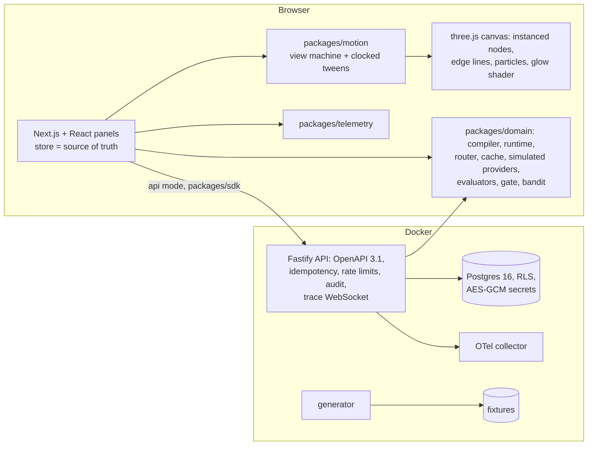

# SYNAPSE: a visual, observable agent builder

An agent-workflow builder where the public site is the product. A story about one support e-mail scrolls over a live canvas and hands over to the
builder. There you place six nodes, wire them, and run them on an e-mail while execution particles travel the edges and nodes glow for latency,
errors and tokens. You can then open the failed tool step to see its retry, swap the model provider, compare both versions on 64 labeled e-mails,
and publish the winner as an API endpoint behind a release gate.

Built from blueprint 02 of the *Motion-First Interactive Product Engineering Build Book (Volume V)* as a **vertical slice**: the demo scenario is
built end to end on the book's stack. The parts that are not built are listed under [Not built, and why](#not-built-and-why).

**Simulated providers.** The four models (two invented providers), the CRM tool, the knowledge base and the e-mails are deterministic simulators in
`packages/domain`. **Nothing calls a real language model.** Each model's accuracy, latency, malformed-output and error rates, and its price list, are
set in `providers.ts`. The quality differences the evaluation finds are therefore the ones written into the simulator: this demonstrates the
harness (routing, retries, tracing, evaluation, gating), not any real model.

- Live sandbox (static, runs entirely in your browser): https://mrrishit909.github.io/projects/synapse-agent-builder/demo/
- 2 min 9 s captioned recording of the whole scenario: [`docs/video/demo.mp4`](docs/video/demo.mp4)
- Case study: https://mrrishit909.github.io/projects/synapse-agent-builder/

## Run it

```bash
docker compose up --build -d --wait     # web :8441, API :8440, Postgres :55440, mail sink :8442, OTel collector, generator
make test                               # 38 unit + API contract tests in Docker against a throwaway Postgres
make e2e                                # 7 Playwright journeys against the static export (needs Google Chrome)
make load-test                          # concurrent runs + 1,000 WebSocket trace streams against a running API
make seed | make reset | make record    # regenerate fixtures / wipe and reseed / re-record the demo video
```

http://localhost:8441 is the same site as the public sandbox, built to run workflows on the API: runs are stored, replayable and streamed, and
publishing creates a real endpoint with a hashed key. The demo tokens are for local use only: `acme-builder-demo`, `acme-viewer-demo`, and
`globex-builder-demo` (a second organisation, used to test tenant isolation). For the static sandbox alone, run
`npm ci && npm run build -w @synapse/web && node scripts/serve.ts` and open :8449.

## The demo, step by step (blueprint section 17)

1. **Build a support workflow from six nodes.** The six are Email trigger → PII filter → Classify (LLM) and Order lookup (CRM tool) in parallel →
   Help-article search → Draft reply (LLM). Place them from the palette (drag, or click to place) and connect them by dragging from a node's right
   edge or with the keyboard connector. The compiler checks the graph on every change. It rejects cycles, a wrong number of inputs, a missing
   model and inline credentials, and it rejects **any path from the trigger to a model that skips the PII filter**. The result is 6 steps in 5
   levels.
2. **Run it on the sample e-mail.** The PII filter removes 1 e-mail address, 1 phone number and 1 card reference before any model sees the text.
   The run takes 5.48 s end to end, costs $0.00180 and uses 235 tokens in and 76 out.
3. **Particles traverse the edges in real time.** Each edge carries the upstream step's output during its 150 ms hand-off. A node glows while it
   works; the glow's reach is the step's share of the run's time, the colour is its outcome (ok, retried, failed, cached), and the bar under it is
   its tokens. The trace waterfall and the cost flame chart below the canvas follow the same clock, and you can scrub it.
4. **Open the failed tool step.** The order lookup timed out after 2.50 s. The runtime waited 250 ms and retried, and the second call took
   163 ms. Classification ran in parallel, so only the draft waited. The tool's credential is `secret://crm-api-key`, resolved inside the runtime;
   its value never appears in a trace, a stored row or a response (tested).
5. **Swap the model provider and rerun.** v2 sends every call to Nova Pro, falling back to Nova Lite. The same e-mail now takes 4.37 s and costs
   $0.00052.
6. **Compare latency, cost and quality** on 64 labeled e-mails (60 generated plus 4 near-duplicates with a different order number):

   | | v1 · Atlas Large | v2 · Nova Pro |
   |---|---|---|
   | Pass rate (right category, every fact in the reply, no PII) | **89.1%** | **82.8%** |
   | Category accuracy | 90.6% | 92.2% |
   | Facts in the reply | 98.9% | 93.3% |
   | Latency p50 / p95 | 3.27 s / 3.94 s | 2.11 s / 2.84 s |
   | Cost per 1,000 runs | $1.65 | $0.48 |
   | JSON repairs | 0 | 4 |

   Nova Pro is 71% cheaper, 28% faster at p95, and slightly better at classifying. But its drafts drop the order number more often, so the
   end-to-end pass rate falls 6.3 points and the account category drops 12.5 points. **The release gate blocks v2.** A gate that looked only at
   classification would have shipped it.
7. **Publish as an API endpoint.** Publishing v2 is refused with the failed rules; v1 publishes. In Docker,
   `POST /v1/endpoints/acme-wf-support-v1/invoke` with the key shown once runs the published version; the key is stored only as a SHA-256 hash.

Also in the comparison panel:

- **Regression matrix:** one square per e-mail per version, with changed outcomes outlined.
- **Evaluator ensemble:** the deterministic checks, embedding similarity to a reference reply, and a simulated LLM judge. The judge is lenient by
  design: it agrees with the checks 92.2% of the time at score ≥ 4, but only 50% of the replies it scores 4 actually pass. Calibrated on half the
  cases, its Brier score on the other half goes from 0.062 to 0.059.
- **Experiment:** over 1,000 requests, a Thompson-sampling bandit sent 9.0% to v2 and passed 89.0%, against 86.3% for a 50/50 A/B split.
- **Semantic cache:** on classification only, 39 hits and no wrong order numbers. On drafts too, 97 hits but **24 replies quoting another
  customer's order**, so the cache stays on classification.

The URL tracks the state. For example, `?tpl=1&swap=nova-pro&v=2&view=compare` reopens the comparison, and `?tpl=1&node=crm&t=1500` reopens the
inspector at 1.5 s into the trace.

## Architecture



| Piece | What it does |
|---|---|
| `packages/domain/graph.ts` | Graph types and the **compiler**. Kahn's algorithm uses a sorted ready set, so the same graph always compiles to the same plan and hash, whatever the node order (snapshot-tested). It also validates arity, models, `secret://` credentials and the PII-path policy, and builds the 2,000-node stress graph. |
| `runtime.ts` | Executes a plan on a **virtual clock**. A step starts when all its inputs are done, plus a 150 ms hand-off. 429s wait 1 s; 500s and timeouts back off exponentially (250 ms base, 2 retries). Malformed JSON gets one repair re-prompt, then the node's fallback model. A provider whose calls exhaust the retries is marked unhealthy for the router. The **semantic cache** is a hashing-trick embedding with a cosine threshold, scoped to classification by default. The **router** picks the best weighted score (quality − 0.02 per $/1k calls − 0.03 per second) among healthy models that fit the context. Every input and output stored in the trace is redacted, and secrets are scrubbed. |
| `providers.ts` | The simulated providers. There are four models with an invented price list, latency distributions (lognormal plus per-output-token time), accuracy (lower on e-mails that mention two categories), malformed-output and 429/500 rates. Also the CRM tool simulator (rejects bad keys, times out on demand) and a 10-article knowledge base with hybrid search (embedding plus category metadata). |
| `evals.ts` | The evaluator ensemble, release gate, judge calibration, bandit-versus-A/B experiment, cache experiment and prompt line diff (LCS). |
| `apps/web` | The Next.js 16 static export. The **canvas** is one orthographic three.js scene: nodes are a single instanced draw with a rounded-rect SDF shader that draws border, glow, progress and token bars; edges are one line set of sampled Béziers; particles are one point set. Labels are an HTML overlay that changes with zoom (shapes only, then names, then live metrics). Dragging a node moves its neighbours on damped springs. The inspector opens with a shared-element morph from the node. Also: palette with drag-and-drop, multi-select, grouping, keyboard connector, prompt editor with diff against v1, waterfall and flame chart, comparison dashboard, publish dialog, failure lab, list view, telemetry HUD, deep links. |
| `apps/api` | One Fastify process with every endpoint in section 6, plus publish and invoke. Every request carries a bearer-token tenant and role, a token-bucket rate limit with `RateLimit-*` headers, and structured errors. Mutations take an Idempotency-Key. The audit log is hash-chained over canonical JSON (jsonb reorders keys). Secrets are encrypted with AES-256-GCM, with the key taken from the environment. There are OpenTelemetry HTTP and Postgres spans, `/metrics` with p50/p95/p99 per route, and `WS /v1/runs/{id}/stream`, which replays a stored trace at its own pace. |
| Postgres | Section 5's tables (`workspaces`, `workflows`, `workflow_nodes`, `runs`, `run_steps`, `evaluations`) plus tenant_id, created_by, updated_at and deleted_at, and new tables for secrets, endpoints, idempotency keys and audit. The API connects as `synapse_app` under row-level security. Saving a graph identical to an existing version returns that version. |

## Motion system (sections 3, 9, 15)

- **Motion follows state.** The store holds the graph, the run trace and the playback clock. `journey.ts` decides which view follows an event,
  and the canvas tweens the camera through `packages/motion` on an explicit clock. Particles, glow and bars are pure functions of the trace and
  the clock (`nodeStates` in `GraphCanvas.tsx`), so a deep link to `t=1500` draws exactly the same frame every time.
- **Zoom reveals detail** instead of scaling the same UI, and the inspector morphs out of the node rather than navigating away.
- **Reduced motion** (OS setting, the toggle or `?rm=1`) jumps runs to their final state and turns camera moves, springs and the morph into instant
  changes. An e2e test checks that every number is still shown. Pause freezes playback and tweens. The list view shows every node, edge and trace
  step as tables. Keyboard: ⌘K, R, Space, ← →, L, M, P, F, Delete, Esc, plus a node list for focusing nodes without a pointer.

## What the tests check

| Test | Result |
|---|---|
| Compiler | inline snapshot of the support plan; same hash under node reordering; each rejection case (cycle, PII bypass, inline secret, missing model, arity, dangling edge, self-loop, duplicate, unknown type); 2,000 nodes / 5,000 edges compile in < 500 ms, deterministically |
| Runtime | parallel scheduling; CRM timeout → 250 ms backoff → retry; replay is byte-identical; no secret in any trace; no PII in any model input; 429 waits 1 s; three 500s → fallback; dead provider fails, router recovers on Nova Pro; one malformed-JSON repair, then fallback; **cost reconciliation**: run total = sum of steps = price list × tokens (20 e-mails) |
| Evaluation | gate blocks v2 on pass rate; gate passes a version against itself; **regression gate on the baseline** (v1 pass rate ≥ 85%); calibration lowers Brier; bandit ≥ A/B; draft cache yields wrong order numbers, classification cache none |
| Coverage | domain + motion: 98.8% statements, 93.1% branches (threshold 85%) |
| API (16 tests, every body validated against the published OpenAPI 3.1) | authz matrix; versioning; run, steps pagination, replay `identical: true`; **no CRM key, raw e-mail address or card digits in any stored row or response**; failure injection over HTTP; tenant escape (Globex gets 404 on Acme's workflow, run and replay; RLS blocks WHERE-less reads and cross-tenant inserts); gate refuses publishing v2 with 409; endpoint needs its key and redacts PII; idempotency replay and 409; audit chain valid; WebSocket stream in order; trace id propagation; 429 with headers |
| Playwright (7 journeys) | the section 17 walk from an empty canvas to a published endpoint with deep-link restore; reduced motion; keyboard only; provider outage and router recovery; rate-limit storm; 2,000-node / 5,000-edge stress; visual baselines of three motion states (mid-run glow at 1.5 s, the finished trace, the comparison) |

## Performance and observability

- **Real GPU** (Chrome on Apple silicon, headless with Metal, measured during the recording): 60 FPS, p95 frame 16.8 ms, 3 draw calls.
- **2,000 nodes and 5,000 edges, software GL** (SwiftShader in the e2e test): 14 FPS, still 3 draw calls (`docs/performance-e2e.json`). This is a
  floor, not a GPU figure.
- **API load** (same machine, `docs/load-test.json`): 32 clients for 10 s gave 1,137 requests a second with 0 errors. A quarter of them were full
  persisted runs (p50 60 ms, p95 80 ms; the simulated providers answer instantly, so this measures the platform, not model latency), and the rest
  were reads (p95 24 ms). 1,000 concurrent trace streams all completed.
- The evaluation of 2 × 64 e-mails runs in the page in about 40 ms. Traces: the browser sends `traceparent`, and the API logs it, returns it in
  errors and exports spans to the collector.

## Tradeoffs

- **One API process instead of eleven services.** The blueprint's workflow-api, compiler, runtime, router, tool executor, memory, retrieval,
  evaluation, trace, secret and billing services all call one domain package, and here they would each wrap one table. The route groups are the
  seams.
- **The same runtime in the browser and on the server.** The public sandbox needs no backend, and the Docker stack stores and audits the very same
  traces. The cost is that the browser's "secret store" is the page's memory. That is fine for a demo key, and it is why credentials are
  references everywhere.
- **Virtual clock, real-time playback.** A run is computed instantly and played back at its simulated latencies. The WebSocket stream does the
  same server-side. Real providers would stream as they go; the trace format is the same.
- **Simulated quality.** Accuracy, fact recall and error rates come from the simulator's settings, so the comparison shows the harness working,
  not which model is better.

## Not built, and why

- Real model, tool and vector-database providers: the book requires demo mode on fixtures, and real calls would cost money and make the numbers
  about someone else's model.
- Temporal durable workflows, Kafka/Redpanda, Redis, pgvector, MinIO/S3, Vault: nothing in this slice needs durable timers, fan-out, a shared
  cache, vectors at scale or large artifacts. The secret store is AES-GCM in Postgres with the key in the environment.
- Subgraphs and reusable components (only visual grouping exists), multi-user editing, prompt experiments wired to live traffic (the bandit runs
  over evaluation outcomes).
- OIDC/SAML, MFA, billing and plans: demo bearer tokens with roles stand in.
- Terraform, Kubernetes worker pools, canary releases, signed images, SBOM: there is no cloud account. The public deployment is the static export
  on GitHub Pages, and `.github/workflows/ci.yml` runs audit, type-check, unit tests with coverage, and Playwright.
- A production-like load test across machines, chaos testing of the database, SLO burn-rate alerts.

## Layout

```
apps/web          Next.js site: story, canvas (src/canvas), panels (src/ui), store, deep links
apps/api          Fastify API, migrations, seed (encrypted secrets)
packages/domain   compiler, runtime, providers, evaluation + tests     packages/motion     view machine, tweens + tests
packages/telemetry  frontend telemetry                                 packages/sdk        typed API client
data/simulators   fixture generator      data/fixtures  e-mails, trace fixtures, price list, eval baseline, provenance
tests/e2e         Playwright             tests/performance  load test     docs  OpenAPI, load and perf results, video
```
